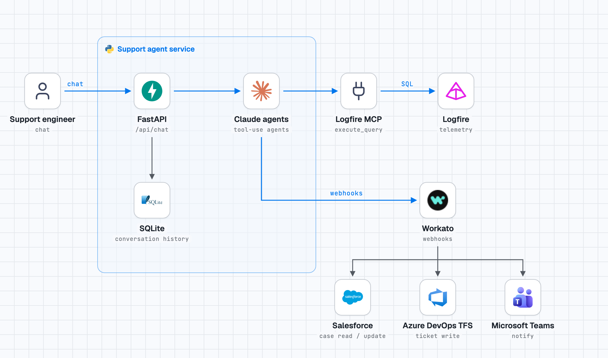

# LogFire Support Agent

<!-- stack-diagram:start -->
<picture>
  <source media="(prefers-color-scheme: dark)" srcset="docs/stack-diagram-dark.png">
  
</picture>
<!-- stack-diagram:end -->


A chat-based investigation agent for support engineers. Replaces Grafana dashboards with
plain-language queries against Logfire telemetry. Detects cross-tenant patterns automatically.

## What It Does

- Ask questions about a customer issue in plain English
- Agent investigates Logfire traces, spans, and logs
- Flags if the same issue affects multiple tenant environments (smoke detection)
- Produces a structured escalation summary ready for TFS (via Workato)

## Prerequisites

- Python 3.11+
- `logfire-mcp` CLI installed: `pip install logfire-mcp`
- A Logfire read token with **cross-project scope** (not scoped to a single project)
- Anthropic API key

## Setup

```bash
# 1. Clone and install
pip install -r requirements.txt

# 2. Configure credentials
cp .env.example .env
# Edit .env — set ANTHROPIC_API_KEY and LOGFIRE_TOKEN at minimum

# 3. Verify Logfire MCP connection
python -c "
import asyncio, os
from mcp import ClientSession, StdioServerParameters
from mcp.client.stdio import stdio_client
async def check():
    p = StdioServerParameters(command='logfire-mcp', args=['--read-token', os.environ['LOGFIRE_TOKEN']])
    async with stdio_client(p) as (r, w):
        async with ClientSession(r, w) as s:
            await s.initialize()
            tools = await s.list_tools()
            print('Connected. Tools:', [t.name for t in tools.tools])
asyncio.run(check())
"

# 4. Start the server
uvicorn api.main:app --reload --port 8000
```

## Using the Agent

```bash
# Investigate a customer issue
curl -X POST http://localhost:8000/api/chat \
  -H "Content-Type: application/json" \
  -d '{"message": "Customer Acme is getting 500s on /api/sync since 14:00 UTC"}'

# Include a Salesforce case ID
curl -X POST http://localhost:8000/api/chat \
  -H "Content-Type: application/json" \
  -d '{"message": "Investigate case SF-12345", "case_id": "SF-12345"}'

# Continue a conversation
curl -X POST http://localhost:8000/api/chat \
  -H "Content-Type: application/json" \
  -d '{"message": "Check if other tenants are seeing this too", "conversation_id": "<id from previous response>"}'
```

## Logfire Token Scope

The `LOGFIRE_TOKEN` must have read access across **all tenant projects**, not just one.
If the token is project-scoped, cross-tenant smoke detection will silently return empty results.

To check: in the Logfire dashboard, generate a read token at the organisation level, not the project level.

## VDI Migration Notes

When moving from laptop to VDI:

1. Confirm `logfire-mcp` binary is installed on VDI (`pip install logfire-mcp`)
2. If `logfire-mcp` is unavailable, switch `LogfireTool.MCP_TOOL_NAME` to use the REST API fallback
3. Set the same `.env` variables — no code changes required
4. If VDI proxies outbound HTTPS, add `api.anthropic.com` to the proxy allowlist
5. SQLite database (`conversations.db`) is local — conversations do not persist across machines

## Workato Integration (Phase 2)

Add these to `.env` when Workato webhooks are ready:

```
WORKATO_WEBHOOK_SF_READ=https://apim.workato.com/...
WORKATO_WEBHOOK_TFS_WRITE=https://apim.workato.com/...
WORKATO_API_KEY=your-workato-api-key
```

The agent works without these — it degrades gracefully and produces ticket text for manual creation.

## Teams Alerting + SF Escalation (Phase 3)

Add these to `.env` to enable automatic Teams notifications and Salesforce case escalation:

```
WORKATO_WEBHOOK_TEAMS_NOTIFY=https://apim.workato.com/...
WORKATO_WEBHOOK_SF_UPDATE=https://apim.workato.com/...
CHAT_BASE_URL=http://your-agent-host:8000
```

All three degrade gracefully if absent — Phase 1/2 functionality is unaffected.

## Architecture Documentation (Phase 4)

Open `docs/architecture/index.html` in any browser (double-click, no server needed) for a full visual overview of the system: request flow, agent roles, tool matrix, integrations, data models, and escalation flow — all with Mermaid diagrams.

## Logfire Reference

The agent queries traces produced by the **Logfire Python SDK**. Key references:

- **Logfire API docs:** https://pydantic.dev/docs/logfire/api/logfire/
- **Trace & span model:** `knowledge/logfire-sdk-reference.md` — explains span attributes, error patterns, and how instrumentation libraries (FastAPI, Anthropic, httpx) structure their spans. The investigator agent uses this via the KnowledgeTool during investigations.

The `LOGFIRE_TOKEN` must have **organisation-level read scope** (not project-scoped) for cross-tenant smoke detection to work.

## Running Tests

```bash
pytest -v
```
