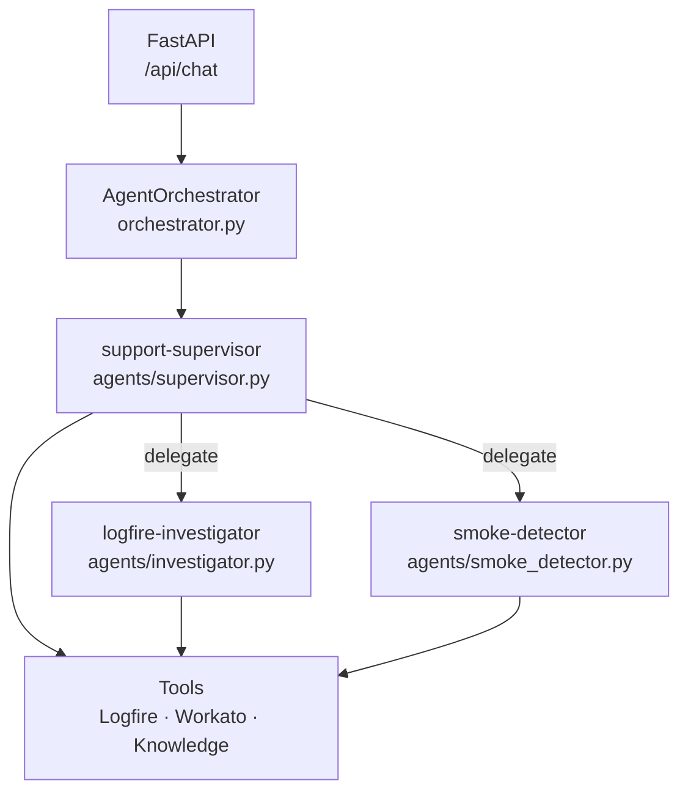
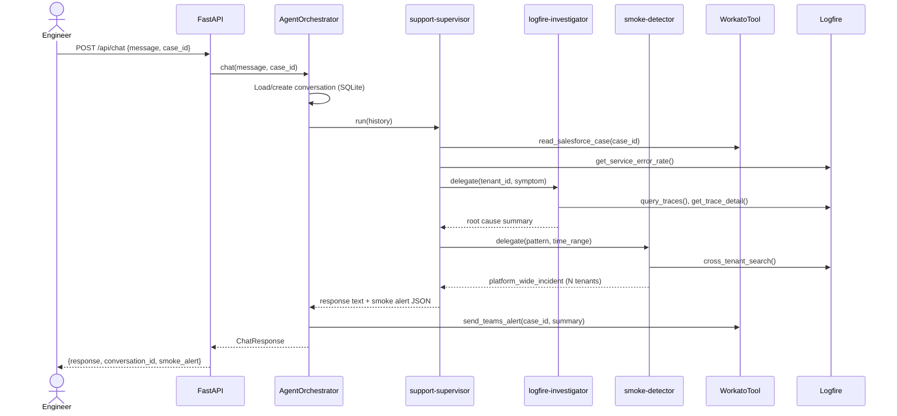
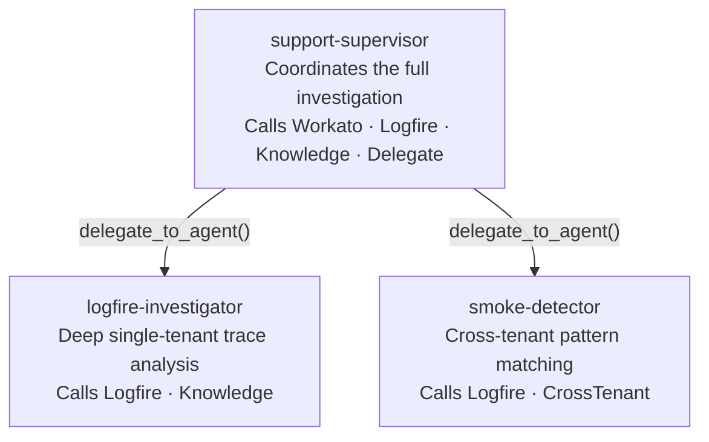
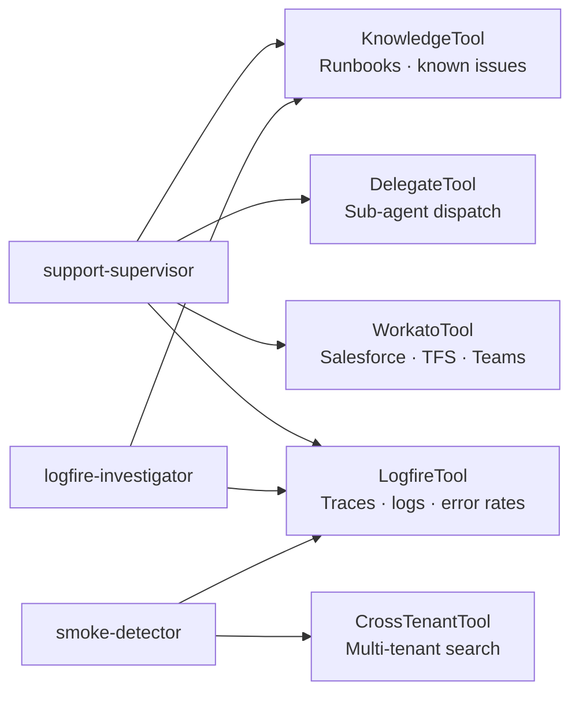
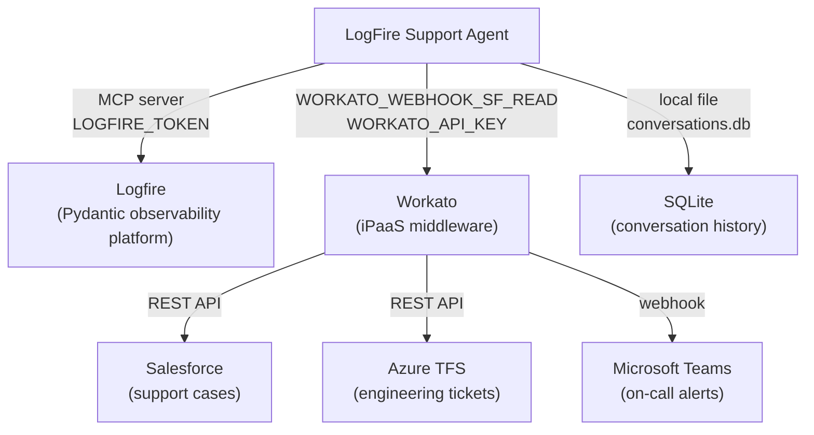
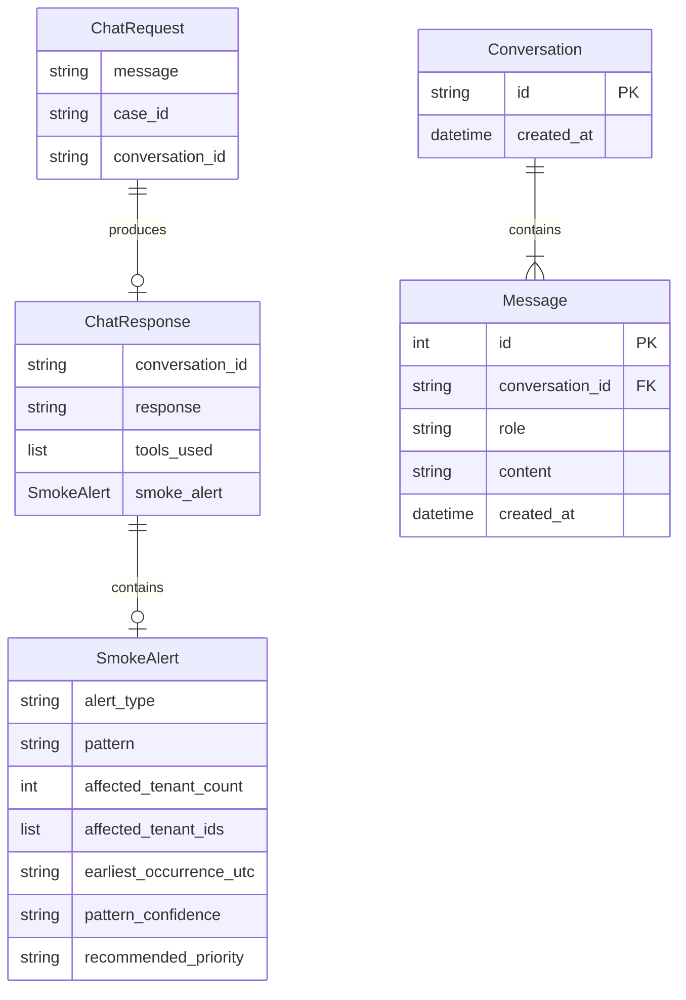

# LogFire Support Agent — Phase 4 Design Spec

**Date:** 2026-04-22
**Status:** Approved
**Author:** Support Engineering

---

## Goal

Produce a single static HTML file (`docs/architecture/index.html`) that explains the LogFire Support Agent architecture to both technical and non-technical readers — enabling clean handoff to another team without requiring any server, toolchain, or prior context.

---

## Constraints

- **Zero dependencies at runtime.** Double-click `index.html` in any browser to open. No `npm install`, no Python server, no build step.
- **No new Python code, no new API endpoints, no new agents.** This is a documentation artifact only.
- **Mermaid.js from CDN.** One `<script type="module">` import. Works offline once cached.
- **One file.** `docs/architecture/index.html` is the entire deliverable. All diagram definitions are embedded inline as `<pre class="mermaid">` blocks.

---

## Layout

### Sidebar navigation

Fixed left column (180px). Lists all 7 sections. Active section highlighted. Project name and phase status at top. Test count at bottom.

### Main area — two tabs per section

Each section has:
- **"What it does"** — plain English prose, 2–4 short paragraphs. Accessible to non-technical readers (support managers, onboarding engineers). No jargon beyond what is explained inline.
- **"How it works"** — Mermaid diagram + file reference tags. For engineers extending or debugging the system.

Tabs switch client-side (no page reload). No frameworks — plain `onclick` handlers and CSS class toggling.

---

## Sections

### 1. System Overview

**What it does:** What the agent is, what problem it solves, the before/after for a support engineer. Brief summary of Phases 1–3.

**How it works:** High-level `graph TB` diagram showing the five main components (API, Orchestrator, Supervisor, Sub-agents, Tools) and how they relate. Not a request flow — a structural map.



**File refs:** `api/main.py`, `orchestrator/orchestrator.py`, `agents/supervisor.py`, `config.py`

---

### 2. Request Flow

**What it does:** How a support engineer's message travels through the system and becomes an investigation result. Covers both the single-tenant and platform-wide paths.

**How it works:** `sequenceDiagram` showing the full lifecycle from `POST /api/chat` through supervisor delegation to smoke alert detection and Teams notification.



**File refs:** `api/main.py`, `orchestrator/orchestrator.py`, `agents/base.py`

---

### 3. Agent Roles

**What it does:** The three agents, what each one is responsible for, and the delegation boundary (sub-agents cannot delegate further).

**How it works:** `graph TD` tree diagram with agent names, one-line roles, and tool access annotated on edges.



Sub-agents (`logfire-investigator`, `smoke-detector`) do not have access to `DelegateTool` — they cannot spawn further agents. This is an intentional safety boundary enforced in `config.py`.

**File refs:** `agents/supervisor.py`, `agents/investigator.py`, `agents/smoke_detector.py`, `config.py`

---

### 4. Tool Matrix

**What it does:** Which tools each agent can call, and what each tool does. Explains why sub-agents have restricted tool access (safety boundary — smoke-detector cannot create TFS tickets).

**How it works:** `graph LR` bipartite diagram — agents on the left, tools on the right, edges showing access.



**File refs:** `tools/logfire_tool.py`, `tools/workato_tool.py`, `tools/knowledge_tool.py`, `tools/cross_tenant.py`, `config.py`

---

### 5. Integrations

**What it does:** Every external system the agent talks to, how it connects, and what happens if the connection is unavailable.

**How it works:** `graph TB` context diagram — agent in centre, external systems around it, connection method and credential on each edge.



All Workato paths degrade gracefully — if a webhook URL is unset, the tool returns a human-readable stub and the investigation continues.

**File refs:** `tools/workato_tool.py`, `tools/logfire_tool.py`, `config.py`

---

### 6. Data Models

**What it does:** The key data structures — what goes in, what comes out, and what's persisted.

**How it works:** `erDiagram` covering the API contract and the SQLite persistence layer.



**File refs:** `api/models.py`, `orchestrator/conversation.py`

---

### 7. Escalation Flow

**What it does:** The full P1 escalation path — from smoke detection through Teams alert to SF case update and TFS ticket creation. Shows exactly where the engineer is in the loop and what the agent does automatically vs. what requires confirmation.

**How it works:** `flowchart TD` with colour-coded nodes (automatic vs. manual gate).

```mermaid
flowchart TD
    A([Engineer sends message]) --> B[Supervisor investigates]
    B --> C{smoke-detector\nconfirms platform-wide?}
    C -->|No| D([Return root cause to engineer])
    C -->|Yes| E[Orchestrator fires\nsend_teams_alert]
    E --> F([Teams alert → on-call channel\nwith conversation link])
    F --> G[Engineer opens conversation\nreviews findings]
    G --> H{Engineer confirms\nP1 escalation?}
    H -->|No| I([Investigation closed\nno ticket created])
    H -->|Yes| J[Supervisor calls\nupdate_salesforce_case_priority P1]
    J --> K[Supervisor calls\ncreate_tfs_ticket]
    K --> L([TFS URL returned in chat\nSF case now P1])

    style E fill:#1a3a5a,stroke:#4af
    style F fill:#1a3a5a,stroke:#4af
    style J fill:#1a3a2a,stroke:#4a9
    style K fill:#1a3a2a,stroke:#4a9
    style H fill:#2a1a0a,stroke:#c84
```



**File refs:** `orchestrator/orchestrator.py`, `tools/workato_tool.py`, `agents/supervisor.py`

---

## File Structure

```
docs/
└── architecture/
    └── index.html      ← the entire deliverable
```

No other files. No images. No external assets beyond the Mermaid CDN import.

---

## Technical Implementation

### Mermaid initialisation

```html
<script type="module">
  import mermaid from 'https://cdn.jsdelivr.net/npm/mermaid@10/dist/mermaid.esm.min.mjs';
  mermaid.initialize({ startOnLoad: true, theme: 'dark' });
</script>
```

### Tab switching

Plain JS — no framework:

```javascript
function switchTab(section, tab) {
  document.querySelectorAll(`[data-section="${section}"] .tab`).forEach(t => t.classList.remove('active'));
  document.querySelectorAll(`[data-section="${section}"] .tab-content`).forEach(c => c.classList.remove('active'));
  document.getElementById(`${section}-tab-${tab}`).classList.add('active');
  document.getElementById(`${section}-content-${tab}`).classList.add('active');
}
```

### Sidebar navigation

```javascript
function showSection(name) {
  document.querySelectorAll('.section-panel').forEach(p => p.classList.remove('active'));
  document.querySelectorAll('.nav-item').forEach(n => n.classList.remove('active'));
  document.getElementById('section-' + name).classList.add('active');
  document.querySelector(`[data-nav="${name}"]`).classList.add('active');
  mermaid.run(); // re-render diagrams on section switch
}
```

---

## Tests

No automated tests for a static HTML file. Manual verification checklist:

- [ ] All 7 sections render without errors in Chrome, Firefox, Safari
- [ ] Mermaid diagrams render correctly in each "How it works" tab
- [ ] Tab switching works on all sections
- [ ] Sidebar navigation highlights the active section
- [ ] File opens via `file://` protocol (double-click) without console errors
- [ ] Page is readable on a 13" laptop screen (1280px wide)

---

## Credentials / Environment

None. The docs file has no secrets and makes no network requests beyond loading Mermaid.js from CDN.
